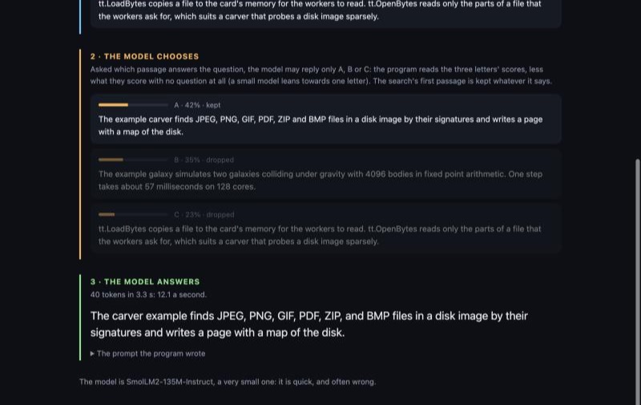

# Ask: a program around a language model

Question answering over a set of documents, with a small language model
and a web page that shows each step as it happens. The source is
[`examples/ask`](https://github.com/pavelgladyshev/tessera/tree/main/examples/ask).



The page while answering "What does the carver example find?" on the card,
with the 360M model.

The model is small and often wrong. The example is about how a program is
put together around a model: what the program does itself, and how it
keeps the model to what it can be trusted with.

## Run it

Download `config.json`, `tokenizer.json` and `model.safetensors` of
[SmolLM2-135M-Instruct](https://huggingface.co/HuggingFaceTB/SmolLM2-135M-Instruct)
into a directory, say `smollm2`. Then:

```bash
go run ./examples/ask -model smollm2 -context 128 -ask "How many workers can a card run?"
```

On the card:

```bash
build/ask/build/ask -model smollm2      # open http://localhost:8090
build/ask/build/ask -model smollm2 -ask "How big is a worker's heap?"
```

It answers from notes about Tessera that are built in. `-docs DIR` adds
the `.md` and `.txt` files of a directory.

## The three steps

1. **The workers search.** The documents are cut into passages. Each
   worker scores its share against the question's words: word stems, and
   the BM25 formula, in integer arithmetic.
2. **The model chooses.** The program labels the best three passages A, B
   and C, asks the model which one answers the question, and reads the
   reply off the scores of those three tokens. The model cannot write
   anything else. A small model leans towards one letter whatever it is
   asked, so the program asks once more with no question and takes that
   lean off.
3. **The model answers** from the passages kept, a token at a time.

The first step is the workers' and the other two are ttnn's, through
`tt/nn`. `main` is the program around them, and the web server.

## The model, in Go

The model is read from its Hugging Face files by the example itself: the
weights from `model.safetensors`, and the byte-level BPE tokenizer from
`tokenizer.json`. A layer is a short list of `tt/nn` calls
(`RMSNorm`, `Linear`, `Attention`, `SiLU`, `Add`).

Two things are arranged when the weights are loaded, so that a layer is
whole-tensor operations only. The rotary position encoding swaps pairs of
columns, which is folded into a second copy of the query and key weights:
`q = (x·Wq)·cos + (x·Wq')·sin`. And the model's 3 key-value heads are
repeated to match its 9 query heads.

The context has a fixed length (384 tokens): the tokens so far, then
padding that the causal mask hides. ttnn builds its programs for a tensor
size the first time it sees it, so a context that grew by a token would
pay about 2 s at every token.

## What it measured

| | 135M | 360M | 1.7B |
|---|---|---|---|
| Tokens a second on the card, context 384, all of it computed again for each token | 18 | 12 | 7 |
| Time to load | 2.7 s | about 6 s | 32 s |
| Correct answers, of 22 questions | 12 | 12 | 14 |

All three are SmolLM2-Instruct models and run with the same code: only the
`-model` directory differs. The 1.7B model's file is 3.4 GB.

The search itself was measured on those 22 questions
(`examples/ask/testdata/questions.tsv`, run with `-eval`): the right
passage is among the first three for 21, and first for 15. Searching by
meaning, with vectors made of the model's own word vectors, was tried and
found no more than the words do; it is there as `-search meaning`.

So the answers are limited by the model, not the search. The models fail
differently: the 135M invents, the 360M sometimes contradicts the note it
was given, and the 1.7B is right more often but still invents when the
note does not have the answer (asked for the author's name with the wrong
note in hand, it said "Golang Core Team"). The count of correct answers
is one reading of 22 answers per model, not a benchmark.

Under `go run` the model is slow, about 0.2 tokens a second at a context
of 256, so use a short `-context` there.

## Not done

Nothing has been done for speed beyond the fixed context: no key-value
cache, no replay of ttnn's recorded operations, both chips doing the same
work. Tenstorrent's own implementations of much larger models are faster
than this one.
