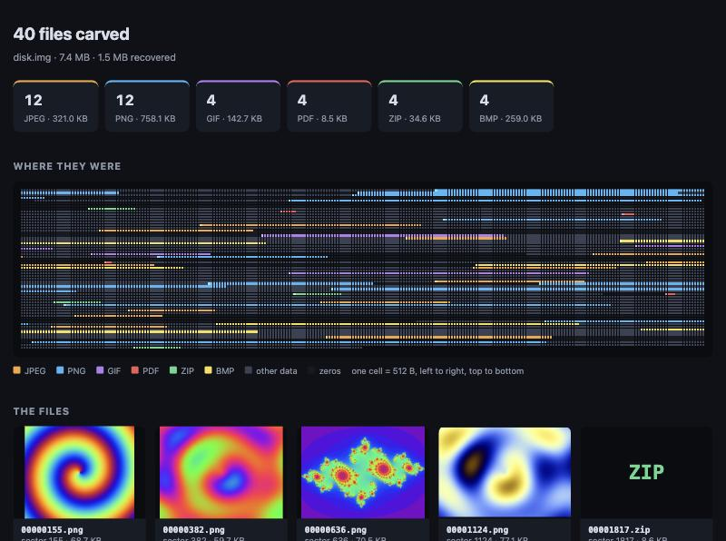

# Carver: finding files in a disk image

A file carver recovers files from a disk image without using the file
system: it looks for the bytes files begin with. This one finds JPEG, PNG,
GIF, PDF, ZIP and BMP files and writes a page that shows where they were.
The source is
[`examples/carver`](https://github.com/pavelgladyshev/tessera/tree/main/examples/carver).



## Run it

```bash
go run ./examples/carver                      # carved/index.html
go run ./examples/carver -img disk.img -o found
```

Without `-img` it makes a disk image to carve: pictures and documents it
draws itself, scattered among zeros, noise and a few decoys that begin
like a file and are not one. On the card: `build/carver/build/carver`.

## How it works

The image is cut into one portion per worker.

* **A worker looks at the start of every sector** for a signature: `FF D8
  FF` for JPEG, `89 PNG` for PNG, and so on.
* **Where it finds one, it follows the file's own structure to its end:** a
  PNG's chunks to `IEND`, a JPEG's segments and scans to its end marker, a
  GIF's blocks to its trailer, a ZIP's end record (checked against where
  its directory is), a BMP's header, a PDF's last `%%EOF`.
* **A signature whose structure does not hold is not a file.** That is
  what rejects the decoys.
* **main writes the files** with `tt.WriteFile`, and the report: a PNG map
  with a cell for every sector, and an HTML page.

A file can run past the end of a worker's portion. The worker keeps
reading: a `tt.Bytes` can be read anywhere. A file found inside another
(a picture stored in a ZIP) is dropped by `main`.

## What it measured

| | |
|---|---|
| Its own test image (7.8 MB, 40 files) | all 40 recovered whole, no others; the same on the card and the CPU |
| A 4.3 GB test image | 1,016 files, the same on both |
| Time on that image | card 4.5 s, of which the workers 0.9 s, reading the file 1.8 s and copying it to the card 0.7 s; CPU (24 cores) 2.2 s |

Plain scanning is not what the card is quick at: a CPU does it as fast.
The carver is here as a readable, complete worker program.

## What writing it turned up

The first run on the card hung without a word. The workers had overflowed
their small stack: the compiler's estimate had missed the copies made
each time a `tt.Bytes` and a slice are passed to a function. Three things
came of it, described in [Limits and troubleshooting](../reference/limits.md):
a better estimate, a notice when workers run long, and `TESSERA_TIMEOUT`.
