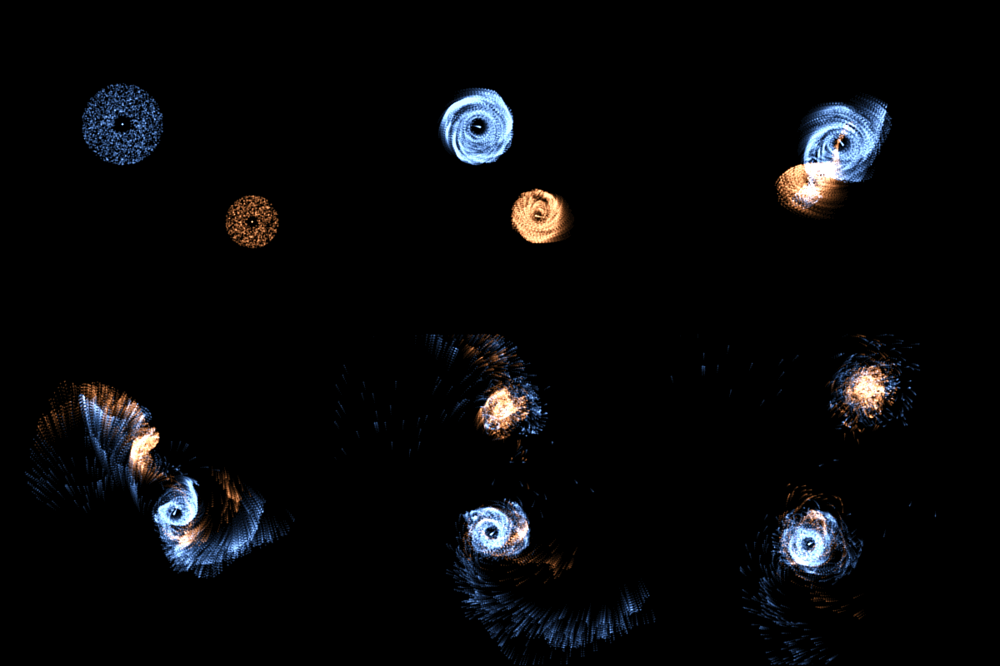
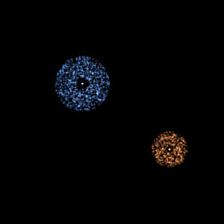

# Galaxy: a gravity simulation

Two disk galaxies fall past each other and pull each other apart. The
source is
[`examples/galaxy`](https://github.com/pavelgladyshev/tessera/blob/main/examples/galaxy/main.go).





## Run it

```bash
go run ./examples/galaxy                     # galaxy.gif and galaxy.png
go run ./examples/galaxy -n 2048 -steps 300  # smaller and shorter
```

On the card, after `tessc` and `build.sh`: `build/galaxy/build/galaxy`.

## Watch it live

```bash
go run ./examples/galaxy -serve localhost:8070    # then open http://localhost:8070
build/galaxy/build/galaxy -serve localhost:8070   # on the card
```

With `-serve` the simulation runs for as long as someone has the page
open, and the page draws every step as it comes from the workers, on a
canvas, with the step rate beside it. You can change the number of
bodies, pause, and start over; the collision starts over by itself after
600 steps. On the card 4,096 bodies run at about 8 steps a second: a step
takes about 118 ms, of which the workers' own work is 57 ms and the rest
is starting them again for each step.

## How it works

Every body attracts every other, so a step is n² pairs: 16.8 million for
4,096 bodies.

* **The workers compute the accelerations.** Each takes a share of the
  bodies and sums, for each of its bodies, the pull of all the others.
* **main moves the bodies**, draws the frame, and writes the files. It is
  ordinary Go: the picture is made with Go's `image` packages.
* **The state travels as a file.** Before each step `main` writes every
  body's position and mass to a small file and loads it with
  `tt.LoadBytes`; the workers read it into arrays.

## Physics without floating point

A worker has no floating point, so the simulation is in fixed point.
Positions are whole numbers of 1/32 of a pixel, the square root is an
integer one, and 1/r³ is a 64-bit division scaled so that sums keep 32
bits below the point:

```go
dx, dy := xs[j]-xi, ys[j]-yi
r2 := uint32(dx*dx+dy*dy) + soft2
q := int64(uint64(pull)/(uint64(r2)*uint64(isqrt(r2)))) * int64(ms[j])
ax += int64(dx) * q
ay += int64(dy) * q
```

The reward is that the card and the CPU agree to the last bit: they print
the same checksum and write identical pictures. The card test checks
that.

## What it measured

| | |
|---|---|
| One step, 4,096 bodies, on 128 cores | 57 ms |
| 600 steps, with the drawing | 72 s on the card; 22 s under `go run` on a 24-core CPU |

The card is slower here: a pair costs a 64-bit division, which the
32-bit cores do in software. The example is about workers and exactness,
not speed.

## What writing it turned up

Calling `tt.Parallel` 600 times found a bug: every `tt.LoadBytes` also
reserved part of each core's memory, and the card ran out after ten
steps. That is fixed, and the example is a test for it.
